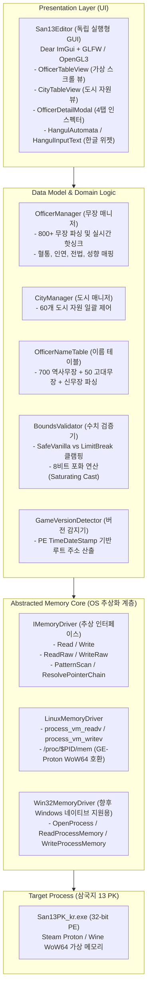

# 시스템 아키텍처 및 디렉터리 구조 명세서 (ARCHITECTURE)

> **기준 판본:** v5.6  
> **최종 갱신일:** 2026-10-01  

---

## 1. 계층형 시스템 아키텍처 (Layered Architecture)

본 프로젝트는 OS 계층, 데이터 도메인 계층, UI 계층이 엄격히 분리된 3계층 아키텍처를 채택하고 있습니다.



---

## 2. 디렉터리 구조 및 역할 (Directory Structure)

```text
vaneditor/
├── README.md                    # 프로젝트 소개, 빌드 및 실행 가이드, 면책 조항
├── Makefile                     # 컴파일, 테스트, 도구, 패키징 스크립트
├── .gitignore                   # 빌드 산출물 및 바이너리 격리 규칙
├── assets/                      # 번들 폰트 및 에셋 디렉터리
│   └── fonts/
│       └── NanumGothic.ttf      # 한글 렌더링용 번들 폰트
├── docs/                        # 분리된 정식 기술 문서
│   ├── OFFSETS.md               # 오프셋, 구조체, 검증 수준 명세
│   ├── CHANGELOG.md             # 마일스톤 및 EDGE-01 ~ EDGE-32 이력
│   ├── VERIFICATION.md          # 테스트 스위트 및 인게임 실측 증거
│   ├── ARCHITECTURE.md          # 아키텍처 및 디렉터리 명세 (본 문서)
│   └── archive/                 # 레거시 누적 명세 보존 디렉터리
│       └── SAN13PK_Memory_Spec.md # 원본 누적 명세서 보존본
├── vendor/                      # 서드파티 라이브러리
│   └── imgui/                   # Dear ImGui (Docking) 경량화 소스
│       ├── VERSION.txt          # 업스트림 커밋 및 브랜치 메타데이터
│       ├── LICENSE.txt          # MIT 라이선스 전문
│       ├── backends/            # glfw, opengl3 백엔드
│       └── misc/cpp/            # imgui_stdlib (std::string 연동)
├── include/                     # C++ 공용 헤더 디렉터리
│   ├── core/                    # OS 추상 메모리 드라이버
│   │   ├── IMemoryDriver.hpp
│   │   └── LinuxMemoryDriver.hpp
│   ├── game/                    # 게임 도메인 로직 및 데이터 구조체
│   │   ├── Bounds.hpp           # 수치 상하한 및 클램핑 로직
│   │   ├── City.hpp             # 도시 데이터 구조체
│   │   ├── CityManager.hpp      # 도시 도메인 매니저
│   │   ├── GameVersion.hpp      # PE 버전 판별 및 RootBase 산출
│   │   ├── Officer.hpp          # 무장 데이터 구조체, 스탯, 전법, 성향, 인연
│   │   ├── OfficerManager.hpp   # 무장 도메인 매니저
│   │   └── OfficerNameTable.hpp # 한글 무장 이름 매핑
│   └── ui/                      # Dear ImGui UI 계층 헤더
│       ├── CityTableView.hpp    # 도시 테이블 뷰
│       ├── FontHelper.hpp       # 한글 폰트 로더
│       ├── HangulAutomata.hpp   # 2벌식 오토마타 엔진
│       ├── OfficerTableView.hpp # 무장 테이블 뷰 및 4탭 인스펙터
│       └── UIManager.hpp        # GLFW / OpenGL3 윈도우 매니저
├── src/                         # C++ 구현부 디렉터리
│   ├── core/
│   │   └── LinuxMemoryDriver.cpp
│   ├── game/
│   │   ├── CityManager.cpp
│   │   ├── GameVersion.cpp
│   │   ├── OfficerManager.cpp
│   │   └── OfficerNameTable.cpp
│   ├── ui/
│   │   ├── CityTableView.cpp
│   │   ├── FontHelper.cpp
│   │   ├── HangulAutomata.cpp
│   │   ├── OfficerTableView.cpp
│   │   └── UIManager.cpp
│   └── main.cpp                 # 독립 실행형 에디터 진입점
├── tests/                       # 12개 단위 테스트 스위트 소스
├── tools/                       # 19개 오프셋 발굴 및 리버스 엔지니어링 도구 소스
└── dist/                        # Linux 독립 배포 패키징 스크립트
    ├── README_LINUX.md          # 리눅스 유저 실행 가이드
    ├── run.sh                   # ptrace 검사 및 자동 런처
    └── san13_editor.desktop     # 데스크톱 바로가기 엔트리
```

---

## 3. 메모리 안전성 및 트랜잭션 설계

1. **원자적(Atomic) 구조체 직렬화:**
   - 무장이나 도시의 수치를 변경할 때 바이트 단위로 쪼개어 쓰지 않고, 완성된 구조체를 한 번에 메모리 블록 단위로 기록하여 게임 엔진의 월말 결산 루틴과의 레이스 컨디션을 방지합니다(EDGE-14).
2. **다중 선택 롤백(Undo) 보장:**
   - 대규모 일괄 수정(50인 스탯 가산, 수명 연장 등) 수행 전 대상 무장의 원본 상태를 `OfficerSnapshot` 배열로 캡처하여, 사용자가 원클릭으로 원래 상태를 완전 복구할 수 있도록 보장합니다.
3. **Strict Bounds Guard:**
   - 사용자 입력값이 8비트 정수 범위를 초과할 때 모듈로 연산으로 수치가 급감하지 않도록 포화 연산(Saturating Cast)을 적용하고, 병종 적성은 `& 0x03` 비트 마스킹으로 유효 범위(0~3) 외의 입력을 원천 차단합니다.
