# 시스템 아키텍처 및 디렉터리 구조 명세서 (ARCHITECTURE)

> **기준 판본:** v6.0  
> **최종 갱신일:** 2026-10-14  

---

## 1. 계층형 시스템 아키텍처 (Layered Architecture)

본 프로젝트는 OS 계층, 데이터 도메인 계층, UI 계층이 엄격히 분리된 3계층 아키텍처를 채택하고 있습니다.

```mermaid
flowchart TD
    subgraph Presentation ["Presentation Layer (UI)"]
        UI_Standalone["San13Editor (독립 실행형 GUI)<br/>Dear ImGui + GLFW / OpenGL3<br/>- OfficerTableView (무장 가상 스크롤 뷰 및 4탭 상세 모달)<br/>- CityTableView (7열 도시 자원 뷰)<br/>- CityDetailModal (경제/내정/군사/부락 4탭 인스펙터)<br/>- ItemTableView (명품 목록 및 시장 위치/수여/몰수)<br/>- HangulAutomata / HangulInputText (한글 위젯)"]
    end

    subgraph DataModel ["Data Model & Domain Logic"]
        DM_Officer["OfficerManager (무장 매니저)<br/>- 2,165 무장 파싱 및 실시간 핫싱크<br/>- 혈통, 다중 인연, 전법, 성향, 시나리오 일자 매핑"]
        DM_City["CityManager (도시 매니저)<br/>- 60개 도시 자원, 인구, 내정, 소속 인물 체인 제어"]
        DM_Settlement["SettlementManager (부락/요충 매니저)<br/>- 300개 부락 개발도 및 CChiiki 요새화 실시간 반영"]
        DM_Item["ItemManager (명품 매니저)<br/>- 234+ 명품 소유권, 시장 소재지 도시 제어"]
        DM_Force["ForceManager (세력 매니저)<br/>- 64개 세력 군주 실명화 및 소속 판별"]
        DM_Tactic["TacticManager (전법 매니저)<br/>- 141개 전법 마스터 테이블"]
        DM_Names["Name Tables (이름 테이블)<br/>- OfficerNameTable: 역사 700 + 고대 + PK 추가 100 + 신무장<br/>- ItemNameTable / SettlementNameTable"]
        DM_Prot["Protagonist (주인공 컨트롤러)<br/>- RootBase + 0x14BC 플레이어 무장/소지금"]
        DM_Bounds["BoundsValidator (수치 검증기)<br/>- SafeVanilla vs LimitBreak 클램핑"]
        DM_Version["GameVersionDetector (버전 감지기)<br/>- PE TimeDateStamp 기반 루트 주소 산출"]
        DM_Platform["PlatformUtil (플랫폼 유틸)<br/>- CP949 디코딩 (iconv / MultiByteToWideChar)<br/>- $HOME / %USERPROFILE% 경로 탐색"]
    end

    subgraph MemoryCore ["Abstracted Memory Core (OS 추상화 계층)"]
        IMem["IMemoryDriver (추상 인터페이스)<br/>- Read<T> / Write<T><br/>- ReadRaw / WriteRaw<br/>- PatternScan / ResolvePointerChain"]
        Driver_Linux["LinuxMemoryDriver<br/>- process_vm_readv / process_vm_writev<br/>- /proc/$PID/mem (GE-Proton WoW64 호환)"]
        Driver_Win["Win32MemoryDriver (Windows 네이티브 완성)<br/>- OpenProcess / ReadProcessMemory / WriteProcessMemory<br/>- EnumProcessModulesEx (PSAPI WoW64 완벽 호환)"]
    end

    subgraph TargetGame ["Target Process (삼국지 13 PK)"]
        Game["San13PK_kr.exe (32-bit PE)<br/>Steam Proton / Wine WoW64 가상 메모리"]
    end

    Presentation --> DataModel
    DataModel --> MemoryCore
    MemoryCore --> TargetGame
```



---

## 2. 디렉터리 구조 및 역할 (Directory Structure)

```text
san13-editor/
├── README.md                    # 프로젝트 소개, 빌드 및 실행 가이드, 면책 조항
├── Makefile                     # 컴파일, 19개 테스트, Windows 크로스 컴파일(make win), 배포 패키징 단일 빌드 스크립트
├── .gitignore                   # 빌드 산출물, 바이너리, scratch 격리 규칙
├── assets/                      # 번들 폰트 및 에셋 디렉터리
│   └── fonts/
│       └── NanumGothic.ttf      # 한글 렌더링용 번들 폰트
├── data/                        # 부락/명품 마스터 JSON/CSV 데이터
├── docs/                        # 분야별 기술 문서 체계 (Documentation Hub)
│   ├── README.md                # 전체 문서 인덱스 및 분야별 가이드
│   ├── specs/                   # 기술 명세 및 메모리 구조체 (SSOT)
│   │   ├── OFFSETS.md           # 오프셋, 구조체, 검증 수준 명세
│   │   ├── ARCHITECTURE.md      # 아키텍처 및 디렉터리 명세 (본 문서)
│   │   └── OFFICER_NAME_SYSTEM.md # 무장 이름 시스템 및 ID 슬롯 분류표
│   ├── plans/                   # 마일스톤별 구현 로드맵 및 계획서
│   │   ├── 01_PROTAGONIST_PLAN.md    # 주인공 기능 구현 계획
│   │   ├── 02_CITY_EXPANSION_PLAN.md # 도시/부락 확장 계획
│   │   ├── 03_CORE_ENHANCEMENT_PLAN.md # Phase 1~5 코어 확장 계획
│   │   ├── 04_UI_ENHANCEMENT_PLAN.md   # 버그 수정, 반응형, 테마 폴리싱 계획
│   │   └── 05_BACKLOG.md               # 진행 중/예정 작업 백로그
│   ├── quality/                 # 품질 검증 및 릴리즈 관리
│   │   ├── VERIFICATION.md      # 테스트 스위트 및 인게임 실측 증거
│   │   ├── QA_CHECKLIST.md      # 배포 전 필수 QA 점검표
│   │   └── CHANGELOG.md         # 버전별 릴리즈 변경 이력
│   └── archive/                 # 레거시 누적 명세 보존 디렉터리
│       └── SAN13PK_Memory_Spec.md # 원본 누적 명세서 보존본
├── vendor/                      # 서드파티 라이브러리
│   └── imgui/                   # Dear ImGui (Docking) 경량화 소스
├── include/                     # C++ 공용 헤더 디렉터리
│   ├── core/                    # OS 추상 메모리 드라이버 및 플랫폼 유틸
│   │   ├── IMemoryDriver.hpp
│   │   ├── LinuxMemoryDriver.hpp
│   │   ├── Win32MemoryDriver.hpp
│   │   └── PlatformUtil.hpp
│   ├── game/                    # 게임 도메인 로직 및 데이터 구조체
│   │   ├── Bounds.hpp           # 수치 상하한 및 클램핑 로직
│   │   ├── City.hpp             # 도시 데이터 구조체
│   │   ├── CityManager.hpp      # 도시 도메인 매니저
│   │   ├── ForceManager.hpp     # 세력 도메인 매니저
│   │   ├── GameVersion.hpp      # PE 버전 판별 및 RootBase 산출
│   │   ├── Item.hpp             # 명품 데이터 구조체
│   │   ├── ItemManager.hpp      # 명품 도메인 매니저
│   │   ├── ItemNameTable.hpp    # 234종 명품 한글 명칭/설명 매핑
│   │   ├── Officer.hpp          # 무장 데이터 구조체, 스탯, 전법, 성향, 인연
│   │   ├── OfficerManager.hpp   # 무장 도메인 매니저
│   │   ├── OfficerNameTable.hpp # 한글 무장 이름 매핑
│   │   ├── Protagonist.hpp      # 주인공(플레이어) 컨트롤러 구조체
│   │   ├── Settlement.hpp       # 부락/요충 데이터 구조체
│   │   ├── SettlementManager.hpp# 부락/요충 도메인 매니저
│   │   ├── SettlementNameTable.hpp # 부락 지명 및 특수 효과 매핑
│   │   └── TacticManager.hpp    # 전법 도메인 매니저
│   └── ui/                      # Dear ImGui UI 계층 헤더
│       ├── CityDetailModal.hpp  # 도시 종합 4탭 인스펙터
│       ├── CityTableView.hpp    # 7열 도시 테이블 뷰
│       ├── FontHelper.hpp       # 한글 폰트 로더
│       ├── HangulAutomata.hpp   # 2벌식 오토마타 엔진
│       ├── ItemTableView.hpp    # 명품 테이블 및 시장 위치 뷰
│       ├── OfficerTableView.hpp # 무장 테이블 뷰 및 4탭 인스펙터
│       └── UIManager.hpp        # GLFW / OpenGL3 윈도우 매니저
├── src/                         # C++ 구현부 디렉터리
│   ├── core/
│   ├── game/
│   ├── ui/
│   └── main.cpp                 # 독립 실행형 에디터 진입점 (반응형 폰트/레이아웃)
├── tests/                       # 단위/통합 테스트 소스 (Makefile 등록 19개, test_offline 5 + test_live 14)
├── tools/                       # 메모리 덤프/스캔 분석 도구 및 S13 아카이브 언패커(unpack_s13.py)
├── scratch/                     # 격리된 임시/실험 스크립트 (.gitignore)
├── San13pictool/                # 서드파티 얼굴 CG 교체 도구 원본 (로컬 참고용, .gitignore)
└── dist/                        # Linux / Windows 독립 배포 패키징 자원
    ├── README_LINUX.md          # 리눅스 유저 실행 가이드
    ├── README_WINDOWS.txt       # 윈도우 유저 실행 가이드 (zip 번들)
    ├── run.sh                   # ptrace 검사 및 자동 런처
    └── san13_editor.desktop     # 데스크톱 바로가기 엔트리
```

---

## 3. 메모리 안전성 및 트랜잭션 설계

1. **원자적(Atomic) 구조체 직렬화:**
   - 무장이나 도시의 수치를 변경할 때 바이트 단위로 쪼개어 쓰지 않고, 완성된 구조체를 한 번에 메모리 블록 단위로 기록하여 게임 엔진의 월말 결산 루틴과의 레이스 컨디션을 방지합니다(EDGE-14).
2. **다중 선택 롤백(Undo) 보장:**
   - 대규모 일괄 수정(50인 스탯 가산, 수명 연장 등) 수행 전 대상 무장의 원본 상태를 `OfficerSnapshot` 배열로 캡처하여, 사용자가 원클릭으로 원래 상태를 완전 복구할 수 있도록 보장합니다.
3. **Strict Bounds Guard:**
   - 사용자 입력값이 8비트 정수 범위를 초과할 때 모듈로 연산으로 수치가 급감하지 않도록 포화 연산(Saturating Cast)을 적용하고, 병종 적성은 `& 0x03` 비트 마스킹으로 유효 범위(0~3) 외의 입력을 원천 차단합니다.
